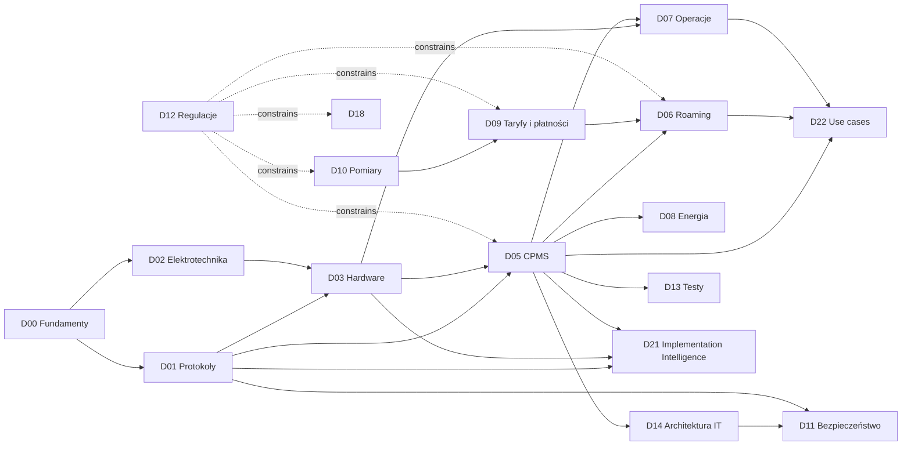

<!-- AUTO-GENERATED copy of taxonomy/TAXONOMY.md by tools/render_taxonomy.py — do not edit by hand. -->

# EV Knowledge Taxonomy v1.0

> Wersja: 1.0.0 · Status: **Zaakceptowana (D0, 2026-11-07)** · Etap planu: 0.1

Taksonomia to mapa całej wiedzy EV Intelligence. Określa, **co istnieje, jak to dzielimy, gdzie co leży i jak obszary od siebie zależą**. Celowo jest szersza niż MVP, żeby za pół roku fundament nie okazał się za wąski. Głęboka treść powstaje jednak tylko tam, gdzie wskazuje priorytet.

| Plik | Rola |
|------|------|
| [`taxonomy.yaml`](taxonomy.yaml) | **Źródło prawdy** (do odczytu maszynowego): domeny, poddomeny, tematy, priorytety, zależności, skille, fasety |
| [`TAXONOMY-TREE.md`](TAXONOMY-TREE.md) | Pełne drzewo, generowane z YAML. Nie edytować ręcznie |
| `TAXONOMY.md` (ten plik) | Zasady, granice domen, zależności, proces zmian |

Regeneracja i walidacja:

```bash
python3 tools/render_taxonomy.py          # waliduje i zapisuje TAXONOMY-TREE.md
python3 tools/render_taxonomy.py --check  # waliduje i sprawdza, czy drzewo jest aktualne
```

---

## 1. Struktura: cztery poziomy

```
Domena (Dnn)           np. D01 Protokoły i standardy komunikacji
 └─ Poddomena (Dnn.mm)  np. D01.01 OCPP
     └─ Temat            np. „Cykl życia transakcji 1.6 vs 2.x”
         └─ Dokument     np. knowledge/protocols/ocpp/transaction-lifecycle-16-vs-2x.md
```

- **Domena i poddomena** mają stały identyfikator (`id`) i klucz katalogu (`key`). Mapują się 1:1 na `knowledge/<domena>/<poddomena>/`.
- **Temat** to jednostka planowania pokrycia. Jeden temat może wymagać jednego lub kilku dokumentów.
- **Dokument** ma frontmatter zgodny z EV Knowledge Standard (Etap 0.2). Pole `domain` wskazuje poddomenę, np. `D01.01`.

## 2. Przegląd 23 domen

Domeny ułożone są warstwowo, od fizyki do biznesu. Trzy domeny są **przekrojowe**: dotykają wszystkich pozostałych.

| Warstwa | Domeny |
|---------|--------|
| Przekrojowe | **D00** Fundamenty i model domenowy · **D21** Implementation Intelligence · **D22** Use cases |
| Fizyczna i pojazd | D02 Elektrotechnika · D03 Hardware · D04 Pojazd i bateria |
| Komunikacja | **D01** Protokoły i standardy |
| Systemy | **D05** CPMS/CSMS · D14 Architektura IT · D15 Dane i AI · D11 Bezpieczeństwo · D13 Testy i certyfikacja |
| Procesy rynkowe | **D06** Roaming · D09 Taryfy i płatności · D10 Pomiary i metrologia · D08 Energia i sieć |
| Operacje i wdrożenie | **D07** Operacje i serwis · D18 Rozwój lokalizacji |
| Rynek i otoczenie | D12 Regulacje · D16 Produkt i UX · D17 Biznes i rynek · D19 Segmenty ładowania · D20 ESG |

**Pogrubione** domeny wchodzą do MVP (Etap 1). Liczby poddomen i tematów oraz pełne drzewo: [`TAXONOMY-TREE.md`](TAXONOMY-TREE.md).

### Obszary mniej oczywiste, dodane celowo

Tych tematów nie było w pierwotnej liście 12 domen. Każdy z nich prędzej czy później wraca w projektach CPMS/CPO:

- **D00.04 Identyfikatory i rejestry**: EVSE ID, EMAID, Party ID. Błędy w ich formatach to częsta przyczyna problemów roamingowych.
- **D10 Pomiary i metrologia prawna** jako osobna domena. MID, Eichrecht i OCMF decydują o tym, czy da się legalnie rozliczać kWh.
- **D13 Testy, zgodność i certyfikacja**: OCTT, plugfesty, symulatory, katalog testów CPMS–EVSE.
- **D15 Dane, analityka i AI**: NAP, DATEX II, predykcyjne utrzymanie, agenci AI w NOC.
- **D18 Rozwój lokalizacji**: wybór miejsca, pozwolenia, uruchomienie i odbiór (w Polsce m.in. dozór UDT).
- **D19 Segmenty ładowania**: floty i zajezdnie, budynki wielorodzinne, ciężarówki i autobusy (MCS), LEV, ładowanie bezprzewodowe, battery swapping.
- **D20 ESG**: gwarancje pochodzenia, kredyty emisyjne w transporcie, CSRD.
- **D04.05 Telematyka OEM**: dane z pojazdu poza ładowarką, przydatne w smart charging.
- **D08.04–D08.06**: przyłącza elastyczne, rynek energii, rynki elastyczności, V2G.
- **D12.03–D12.04**: NIS2, CRA, akt delegowany RED, RODO, Data Act, European Accessibility Act.
- **D01.11 Standardy w przygotowaniu**: IEC 63110, IEC 63119, przyszłe wersje OCPP/OCPI.

## 3. Fasety: wymiary przekrojowe

Poza miejscem w drzewie każdy dokument może być oznaczony fasetami. Pozwala to filtrować wiedzę bez duplikowania struktury, np. „wszystko dla eMSP w Polsce na etapie *operate*”.

| Faseta | Przykładowe wartości | Do czego służy |
|--------|----------------------|----------------|
| `actor` | cpo, emsp, hub, dso, site-host, noc-operator… | Perspektywa roli; dobór treści dla persony |
| `lifecycle` | plan, design, deploy, operate, settle… | Etap cyklu życia |
| `layer` | physical-electrical, device, backend, inter-system, business, regulatory | Warstwa techniczna |
| `knowledge_type` | normative, vendor, expert, implementation, product | Rodzaj wiedzy (nie mieszamy normy z decyzją produktową) |
| `source_class` / `confidence` | A–D / official…hypothesis | Wiarygodność |
| `region` | eu, pl, de, nl, uk… | Jurysdykcja |
| `segment` | public-dc, fleet-depot, multi-family… | Kontekst użycia (D19) |

Pełne listy wartości są w `taxonomy.yaml → facets`. Szczegółowe reguły ich stosowania określi EV Knowledge Standard (Etap 0.2).

## 4. Zależności między domenami

`depends_on` oznacza: *żeby dobrze zrozumieć tę domenę, potrzebna jest wiedza z tamtej*. Na tej podstawie ustalamy kolejność prac, a skill-router dobiera dodatkowe skille.



**Konsekwencja dla MVP.** D06 Roaming (MVP) zależy od D09 Taryfy (P2), a D03 Hardware (MVP) od D02 Elektrotechnika (P2). W Etapie 1 powstaje więc **minimalny wycinek** domen zależnych: CDR i podstawy taryf w OCPI oraz typy złączy i tryby ładowania. Pełne opracowanie tych domen przychodzi w Etapie 4.

## 5. Reguły granic: gdzie co należy

Wiele tematów leży na styku domen. Żeby uniknąć dziesięciu sprzecznych opisów tego samego, każdy temat ma **jednego właściciela**. Pozostałe domeny tylko się do niego odwołują (`related`) i nie powtarzają treści.

| Temat | Właściciel | Odwołują się |
|-------|-----------|--------------|
| Komunikaty i parametry protokołu (np. `RemoteStartTransaction`) | D01 | D05, D07, D22 |
| Jak CPMS obsługuje proces (maszyna stanów, retry, UI) | D05 | D01, D16 |
| Scenariusz end-to-end łączący wiele domen | D22 | wszystkie użyte |
| Zachowanie konkretnego modelu/firmware odbiegające od standardu | D21 | D03, D01 |
| Karta techniczna urządzenia (deklaracje producenta) | D03 | D21 |
| Typy złączy (fizyka) | D02.02 | D01 (mapowanie enumów), D03 |
| Podpisane wartości pomiarowe (OCMF) | D10.03 | D01, D09 |
| Profile smart charging w OCPP (komunikaty) | D01.01 | D08.01 (strategie i algorytmy) |
| Security profiles OCPP | D11.01 | D01.01 |
| Wymóg prawny (np. płatność ad hoc z AFIR) | D12 | D09 (implementacja), D16 (UX) |
| Definicja KPI dostępności | D07.05 | D05.04 (wyliczanie), D12 (definicja regulacyjna) |
| Procedura dozoru / odbioru urządzeń | D12.05 (wymóg) | D07.04, D18.04 (proces) |

Zasada ogólna: **norma lub regulacja → D01/D02/D10/D12; jak to działa w urządzeniu → D03; jak to zaprojektować w systemie → D05/D14; jak tego używać w codziennej pracy → D07; co dzieje się naprawdę → D21; jak to połączyć → D22.**

## 6. Priorytety

| Priorytet | Znaczenie | Domeny/poddomeny |
|-----------|-----------|------------------|
| **MVP** | Treść powstaje w Etapie 1 (tydz. 4–10) | D00, D01.01 OCPP, D01.02 OCPI, D03 (kategorie, karty, firmware, diagnostyka), D05 (architektura, flota, sesje, statusy, urządzenia zewnętrzne), D06 (modele, onboarding, synchronizacja, settlement), D07 (monitoring, diagnostyka, incydenty), D21 (quirks, obejścia), D22 (sesje, łączność, onboarding) |
| **P2** | Etap 4 (tydz. 12–26), kolejność według potrzeb pilotów | D02, D04, D08, D09, D10, D11, D12 (AFIR, PL), D13, D14, pozostałe poddomeny MVP |
| **P3** | Później albo na żądanie klienta | D15–D20, protokoły niszowe (eMIP, OCHP, CHAdeMO/GB/T), standardy w przygotowaniu |

Priorytet to decyzja o **głębokości**, a nie o istnieniu. Domena P3 ma od razu katalog, opis i listę tematów, więc agent wie, że obszar istnieje i że wiedzy jeszcze brakuje. To lepsze niż zgadywanie.

## 7. Poza zakresem (świadomie)

Żeby taksonomia nie rozrastała się bez końca, poniższe obszary **nie** są objęte bazą. Mogą się w niej pojawić tylko jako krótkie odwołania:

- projektowanie i produkcja pojazdów oraz ogniw (poza wpływem na ładowanie, D04);
- infrastruktura wodorowa, CNG/LNG i inne paliwa alternatywne;
- elektryfikacja kolei, lotnictwa i żeglugi (shore power). Może wrócić jako P3 w D19;
- ogólna wiedza IT niezwiązana z EV (D14 opisuje tylko wzorce w kontekście EV);
- doradztwo prawne i podatkowe. D12 i D09 opisują wymagania, nie zastępują porady prawnika ani doradcy podatkowego.

## 8. Elementy do weryfikacji ⚠️

Poddomeny z flagą `verify: true` zawierają nazwy wersji, numery norm albo statusy dokumentów, które **trzeba potwierdzić w źródle pierwotnym**. Zrobimy to w Etapie 0.6 (rejestr źródeł) i w comiesięcznym monitoringu. Do tego czasu traktujemy je jako punkt wyjścia, a nie zweryfikowany fakt. Dotyczy to m.in.:

- ~~wersji OCPP 2.1 i statusu OCPP 2.0.1 jako IEC 63584~~ — sprawdzone w dokumentach OCA (`sources/oca-ocpp.yaml`,
  `skills/ev-ocpp-expert/references/wersje-i-status.md`); numer części IEC 63584 dla 2.0.1 nadal nieustalony;
- ~~wersji OCPI 2.3.0 i statusu prac nad OCPI 3.0~~ — sprawdzone u EVRoaming Foundation (`sources/evrf-ocpi.yaml`,
  `skills/ev-ocpi-roaming-expert/references/wersje-i-role.md`);
- aktualnych wersji OICP i eMIP, statusu OCHP;
- części ISO 15118 i ich statusu, numerów norm MCS;
- statusu IEC 63110 i IEC 63119, OpenADR 3.0, EN 18031;
- zakresu aktów wykonawczych AFIR — częściowo sprawdzone: wersja skonsolidowana AFIR (zmiany 2025/656, 2025/671) i
  rozporządzenie 2025/655 (`sources/eu-afir.yaml`); pozostają EPBD, RED III, przepisy krajowe PL (UDT, URE);
- formatów identyfikatorów (eMI3 / ISO 15118) i operatorów rejestrów ID.

## 9. Zarządzanie zmianami

- **Wersjonowanie semantyczne** taksonomii: `MAJOR` oznacza zmianę struktury domen lub przeniesienie poddomen (wymaga migracji dokumentów), `MINOR` nowe poddomeny, tematy lub fasety, `PATCH` poprawki opisów.
- **Identyfikatory są stałe.** Usunięty węzeł dostaje `status: deprecated` i wskazanie następcy. Jego `id` nigdy nie wraca do użycia.
- **Zmiana = pull request** z aktualizacją `taxonomy.yaml`, regeneracją `TAXONOMY-TREE.md` i, przy wersji MAJOR, planem migracji dokumentów.
- **Przegląd kwartalny**: pokrycie tematów, zgłoszone luki (pytania, na które agent nie znalazł domeny) i nowe obszary z monitoringu standardów.
- W CI (Etap 0.7) uruchamiane będzie `python3 tools/render_taxonomy.py --check`.

## 10. Pytania otwarte do decyzji D0

1. **Granularność regionów.** Czy oprócz PL i UE od razu opracowujemy karty krajów (DE, NL, FR, UK), czy dopiero na żądanie pilotów?
2. **Wiedza produktowa (`knowledge_type: product`).** Czy decyzje dotyczące konkretnego CPMS (własnego lub klienta) mają leżeć w tym repozytorium w osobnym katalogu, czy w oddzielnych, prywatnych repozytoriach? Rekomendacja: oddzielne repozytoria, żeby baza pozostała neutralna i nadawała się do sprzedaży.
3. **Język treści.** Taksonomia jest po polsku, a klucze po angielsku. Czy dokumenty wiedzy piszemy po polsku, po angielsku, czy dwujęzycznie? Rekomendacja: angielski dla treści technicznej (rynek UE i międzynarodowi klienci), polski dla D12.05 i materiałów lokalnych.
4. **Kolejność P2.** Domyślnie: D09 → D08 → D11/ISO 15118 → D12 → D13. Do potwierdzenia po rozmowach z pilotami.
